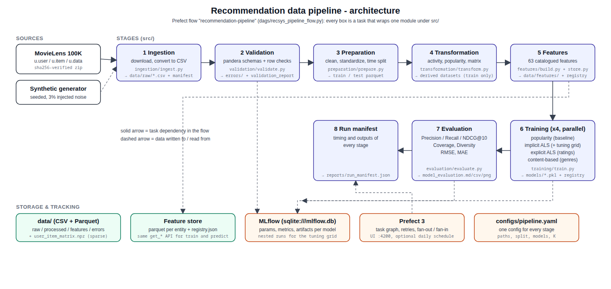

# Recommendation pipeline — end-to-end data management for a recommender system

An end-to-end, reproducible data management pipeline for a movie recommendation
system, built for *Data Management for Machine Learning — Assignment 2*.

```
Ingestion → Validation → Preparation → Transformation → Feature management → Training → Evaluation → Orchestration
```

The pipeline ingests the public **MovieLens 100K** dataset (943 users, 1,682
movies, 100,000 ratings), validates it with [pandera](https://pandera.readthedocs.io/)
schemas and row-level checks, cleans and splits it **by time**, derives user /
item / interaction datasets, computes **63 catalogued features** into a small
file-backed feature store, trains **four recommenders** (a popularity baseline,
implicit-feedback ALS, explicit-rating ALS and a content-based model) tracked
in **MLflow**, evaluates them with Precision@10, Recall@10, NDCG@10, Coverage,
Diversity, RMSE and MAE, and runs the whole thing as a **Prefect** flow.



## Results (MovieLens 100K, per-user time split, K = 10)

| model                    | P@10   | R@10   | NDCG@10 | coverage | diversity | RMSE   | MAE    |
|:-------------------------|-------:|-------:|--------:|---------:|----------:|-------:|-------:|
| popularity (baseline)    | 0.0773 | 0.0659 | 0.0957  | 0.0422   | 0.6458    | 1.0734 | 0.8587 |
| **implicit_als**         | **0.1102** | **0.1341** | **0.1476** | 0.3532 | **0.7010** | n/a | n/a |
| als_matrix_factorization | 0.0760 | 0.0634 | 0.0903  | 0.2027   | 0.6878    | **0.9744** | **0.7695** |
| content_based_genres     | 0.0178 | 0.0167 | 0.0232  | **0.4810** | 0.1305  | 1.1246 | 0.8933 |

Implicit ALS is the best *ranker* (NDCG@10 +54 % over the popularity baseline,
twice the recall, eight times the coverage); explicit ALS is the best *rating
predictor* (RMSE 0.974 vs 1.073 for the item-average baseline). The full table
with notes is in [`reports/model_evaluation.md`](reports/model_evaluation.md),
the comparison chart in `reports/figures/metrics_comparison.png`.

## Quick start

Requirements: Python 3.10+ (developed on 3.12), `make`, internet access for
the one-time 5 MB dataset download (or use the synthetic dataset, see below).

```bash
git clone https://github.com/Huzna-git/wms-dmml && cd wms-dmml
python -m venv .venv && source .venv/bin/activate
pip install -r requirements.txt

make pipeline        # the whole pipeline as a Prefect flow  (~30 s)
make test            # unit tests
```

`make pipeline` runs `dags/recsys_pipeline_flow.py`: eight tasks with explicit
dependencies, the four training tasks fanned out in parallel. Every stage can
also be run on its own, in order, without Prefect:

```bash
make ingest          # python -m src.cli ingest      → data/raw/*.csv + ingestion_manifest.json
make validate        # python -m src.cli validate    → data/errors/, reports/validation_report.{md,json}
make prepare         # python -m src.cli prepare     → data/processed/{users,items,interactions,train,test}.parquet
make transform       # python -m src.cli transform   → user_activity_summary, item_popularity, item_genres, user_item_matrix.npz
make features        # python -m src.cli features    → data/features/*.parquet + registry.json, reports/feature_catalog.md
make train           # python -m src.cli train       → models/*.pkl, models/registry.json, MLflow runs
make evaluate        # python -m src.cli evaluate    → reports/model_evaluation.{md,csv,json}, figures/metrics_comparison.png
make stages          # all of the above in one go (plain Python, no orchestrator)
```

To see the experiment tracking and the orchestration UIs:

```bash
make mlflow-ui       # http://127.0.0.1:5000  (SQLite backend: mlflow.db)
make prefect-server  # http://127.0.0.1:4200  — then, in another shell:
PREFECT_API_URL=http://127.0.0.1:4200/api make pipeline
make schedule        # serve the flow on a daily 02:00 schedule
```

`make synthetic` runs the same pipeline on a documented synthetic dataset with
3 % injected noise (`configs/pipeline.synthetic.yaml`), writing to its own
folders — the easiest way to see the validation stage reject records.

## Project structure

```
recommendation-pipeline/
├── configs/
│   ├── pipeline.yaml             # ONE config for every stage (paths, split, models, K, MLflow)
│   └── pipeline.synthetic.yaml   # same pipeline on synthetic data with injected noise
├── dags/
│   └── recsys_pipeline_flow.py   # Prefect flow: tasks, dependencies, fan-out, schedule
├── data/                         # generated (git-ignored): raw/ processed/ features/ errors/
├── models/                       # generated: <model>.pkl, registry.json (MLflow run ids)
├── reports/
│   ├── validation_report.md/.json, feature_catalog.md, model_evaluation.md/.csv/.json, run_manifest.json
│   ├── figures/                  # architecture.svg/png, metrics_comparison.png
│   ├── screenshots/              # execution output of every stage + UI captures
│   └── final_report.md / .pdf    # the short final report
├── scripts/
│   ├── capture_screenshots.py    # runs each stage and renders its output; captures UI pages
│   └── build_report.py           # Markdown → PDF
├── src/
│   ├── common/        config.py, logging.py, io.py, stage.py
│   ├── ingestion/     ingest.py, movielens.py, synthetic.py
│   ├── validation/    validate.py, schemas.py (pandera), checks.py, report.py
│   ├── preparation/   prepare.py (cleaning, standardization, time-based split)
│   ├── transformation/transform.py (derived datasets, sparse interaction matrix)
│   ├── features/      definitions.py (catalog), build.py, store.py (feature store)
│   ├── training/      base.py, popularity.py, implicit_als.py, matrix_factorization.py, content_based.py, train.py
│   ├── evaluation/    metrics.py, evaluate.py
│   └── cli.py         # python -m src.cli <stage>|all
├── tests/                        # pytest: validation, split, metrics, features, models
├── Makefile
├── requirements.txt
└── README.md
```

## Stage by stage

1. **Ingestion** (`src/ingestion`) — downloads the MovieLens archive (SHA-256
   verified, skipped when present) and converts `u.user`, `u.item`, `u.data`
   into three canonical CSVs: `users` (user_id, age, gender, occupation,
   zip_code), `items` (item_id, title, release_date, imdb_url, genres) and
   `interactions` (user_id, item_id, rating, timestamp). Nothing is cleaned
   here; an `ingestion_manifest.json` records source, checksum and row counts.
   The alternative source is a seeded synthetic generator with documented,
   deliberately injected noise.
2. **Validation** (`src/validation`) — raw columns are read as strings and
   coerced to declared types (an unconvertible value is an `invalid_type`
   error), then pandera schemas check nulls, ranges (rating 1–5, age 5–110,
   timestamp window), categories and key uniqueness, and row-level checks add
   exact duplicates, conflicting duplicate keys, referential integrity
   (interaction → user / item), date parsing and duplicate titles. Rows with an
   *error* are removed and written to `data/errors/<table>_errors.csv` with
   their reasons; *warnings* are kept and reported. Output:
   `reports/validation_report.md` (+ `.json`). On MovieLens all 22 checks pass
   with two warnings (one movie without a release date, 18 titles that appear
   under two ids); on the synthetic data the same checks catch 1,400 injected
   bad rows of seven kinds.
3. **Preparation** (`src/preparation`) — standardizes formats (gender,
   occupation, dates, UTC timestamps), handles missing values (missing release
   year flagged, filled later with the catalogue median), drops residual
   duplicates and makes the **time-based split**: each user's interactions are
   ordered by time and the last 20 % are held out (`per_user_time`; a global
   cut-off is the alternative). The split is described in `split_manifest.json`.
4. **Transformation** (`src/transformation`) — derived datasets from the train
   split only: `user_activity_summary`, `item_popularity` (ranked by
   `log1p(n) × mean rating`), the `item_genres` one-hot table and the sparse
   `user_item_matrix.npz` (943 × 1,682, 95 % sparse) with its index map.
5. **Feature management** (`src/features`) — 30 user, 29 item and 4
   interaction features declared once in `definitions.py` (the catalog,
   rendered to `reports/feature_catalog.md`), computed by pure functions in
   `build.py` from train data only (recency uses the latest train timestamp as
   reference) and written by `store.py` to parquet with a `registry.json`.
   The store refuses a column that is not in the catalog, and the same
   `get_user_features / get_item_features / get_interaction_features` calls
   serve training and prediction. The content-based model reads its user and
   item representations from the store.
6. **Training** (`src/training`) — four models behind one `Recommender`
   interface (`fit`, `recommend`, `predict_rating`): the **popularity**
   baseline; **implicit ALS** (confidence-weighted matrix factorization for
   ranking, hyper-parameters chosen by a small grid on a validation split
   carved from train by the same time rule, every candidate a nested MLflow
   run); **explicit ALS** (biased matrix factorization that predicts ratings;
   ranks by predicted rating plus a popularity prior); and **content-based**
   filtering on genre profiles. Each model is an MLflow run with parameters,
   training metrics (per-epoch RMSE for ALS), the pickled model and sample
   recommendations as artifacts.
7. **Evaluation** (`src/evaluation`) — for every test user with at least one
   relevant held-out item (rating ≥ 4) the model produces a top-10 list that
   excludes the user's train items; Precision@10, Recall@10, NDCG@10, Coverage
   (share of the catalogue recommended at least once) and Diversity (1 − mean
   intra-list genre similarity) are averaged over users, RMSE/MAE over all
   held-out ratings for the rating predictors. Results go to the model's MLflow
   run, `reports/model_evaluation.{md,csv,json}` and a chart.
8. **Orchestration** (`dags/recsys_pipeline_flow.py`) — a Prefect 3 flow;
   each task wraps one stage function and receives the upstream result, so the
   dependency graph is explicit, a failed stage stops its downstream, ingestion
   retries on a network error, the four training tasks run in parallel and a
   `run_manifest.json` records timing and outputs of every task. The flow can
   be served on a cron schedule (`make schedule`).

## Reproducibility

* One configuration file drives every stage; a second file is all it takes to
  run on another dataset.
* Fixed random seed; the ALS solvers are deterministic given the seed, so two
  runs give identical metrics.
* Pinned `requirements.txt`; the dataset download is checksum-verified.
* Every stage returns a `StageResult` (timing, outputs, metrics) that the flow
  writes to `reports/run_manifest.json`; logs go to `logs/pipeline.log`.
* `make test` covers the validation checks, the time split, the metrics, the
  feature store and the model interface.

## Limitations

See the final report (`reports/final_report.md`): no cold-start handling
beyond fallbacks, a single-machine feature store, offline metrics only, no
model registry / serving step, MovieLens is a small 1998 dataset.
