# End-to-End Data Management Pipeline for a Recommendation System

<p class="meta"><b>Data Management for Machine Learning — Assignment 2</b> · Roll no. 2025AG05447 · November 2026<br>
GitHub repository: <a href="https://github.com/Huzna-git/movielens-data-pipeline-dmml">https://github.com/Huzna-git/movielens-data-pipeline-dmml</a> · Dataset: MovieLens 100K (GroupLens)</p>

## 1. Problem and scope

The task was to build a reproducible data management pipeline for a recommender, not a single notebook: raw user, item and interaction data must be ingested, validated, prepared, transformed into derived datasets and features, used to train and evaluate at least two recommenders, and the whole workflow must be orchestrated. I chose the public **MovieLens 100K** dataset because it is small enough to run end-to-end in under a minute yet carries the three required entities with real quirks: 943 user profiles (age, gender, occupation, zip), 1,682 movies (title, release date, 19 genre flags) and 100,000 timestamped 1–5 ratings from September 1997 to April 1998. A seeded synthetic generator with deliberately injected noise is a second, switchable source.

## 2. Pipeline design

<figure>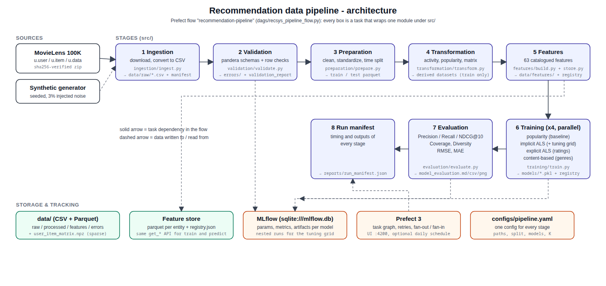<figcaption>Figure 1 — Architecture. Each box is a Prefect task wrapping one module under <code>src/</code>; solid arrows are task dependencies, dashed arrows data written to or read from storage and tracking.</figcaption></figure>

One YAML file (`configs/pipeline.yaml`) drives every stage; a second file is all it takes to run the same code on the synthetic data. Every stage is a pure function `run_<stage>(cfg) -> StageResult` that records timing, metrics and the files it produced, so the flow can write a complete run manifest.

<table class="stages"><thead><tr><th>#</th><th>Stage (module)</th><th>What it does</th><th>Output</th></tr></thead><tbody>
<tr><td>1</td><td>Ingestion (<code>src/ingestion</code>)</td><td>Downloads the archive (SHA-256 verified, skipped when present) and converts the three pipe/tab-separated files into canonical CSVs. Nothing is cleaned here. Because the source is already clean, a counted set of 390 corrupt rows is <b>appended</b> (documented fault injection, switchable off) so validation has work to do.</td><td><code>data/raw/{users,items,interactions}.csv</code>, <code>ingestion_manifest.json</code></td></tr>
<tr><td>2</td><td>Validation (<code>src/validation</code>)</td><td>Reads raw columns as strings, coerces types, runs <b>pandera</b> schemas (nulls, ranges, categories, unique keys) and row-level checks (exact and conflicting duplicates, referential integrity, date parsing, duplicate titles). Error rows are removed and written with their reasons; warnings are kept.</td><td><code>data/errors/{users,items,interactions}_errors.csv</code>, <code>reports/validation_report.{md,json}</code>, <code>*_validated.parquet</code></td></tr>
<tr><td>3</td><td>Preparation (<code>src/preparation</code>)</td><td>Standardizes formats (gender, occupation, dates, UTC timestamps), handles missing values and residual duplicates, and makes the <b>time-based split</b>: each user's history ordered by time, the last 20 % held out (users with < 5 ratings stay in train).</td><td><code>users/items/interactions/train/test.parquet</code>, <code>split_manifest.json</code></td></tr>
<tr><td>4</td><td>Transformation (<code>src/transformation</code>)</td><td>Derived datasets from the <b>train split only</b>: user activity summary, item popularity (<code>log1p(n) × mean rating</code>), item × genre one-hot table, sparse user–item matrix (943 × 1,682, 95 % sparse).</td><td>parquet tables, <code>user_item_matrix.npz</code> + index</td></tr>
<tr><td>5</td><td>Features (<code>src/features</code>)</td><td>30 user, 29 item and 4 interaction features declared once in a catalog, computed by pure functions and written to a file-backed <b>feature store</b> with a registry.</td><td><code>data/features/*.parquet</code>, <code>registry.json</code>, <code>reports/feature_catalog.md</code></td></tr>
<tr><td>6</td><td>Training (<code>src/training</code>)</td><td>Five models behind one <code>Recommender</code> interface, each an <b>MLflow</b> run with parameters, metrics and artifacts; implicit ALS and the hybrid's blend weights are tuned on a validation split with nested runs.</td><td><code>models/&lt;model&gt;/{model.pkl,meta.json}</code>, <code>models/training_summary.json</code>, MLflow</td></tr>
<tr><td>7</td><td>Evaluation (<code>src/evaluation</code>)</td><td>Precision@10, Recall@10, NDCG@10, Coverage, Diversity for every model; RMSE/MAE for the rating predictors. Metrics are logged to the model's MLflow run.</td><td><code>reports/model_evaluation.{md,csv,json}</code>, chart</td></tr>
<tr><td>8</td><td>Orchestration (<code>dags/</code>)</td><td><b>Prefect 3</b> flow with explicit dependencies, retries on ingestion, the four base training tasks fanned out in parallel and the hybrid after them, a run manifest at the end, optional daily schedule.</td><td><code>reports/run_manifest.json</code>, Prefect UI</td></tr>
</tbody></table>

**Design decisions.** (i) *Validation before any cleaning*: the raw data is landed as-is so the checks run on the real thing, and raw strings are coerced inside the validator so a garbage value becomes a row-level `invalid_type` error instead of a crash. (ii) *Train-only derivation*: derived datasets, features and the hyper-parameter search never see the test period; recency features use the latest train timestamp as reference. (iii) *Per-user time split* rather than a random split, because a recommender is used to predict a user's *next* actions; a global cut-off is available as an option. (iv) *A declared feature catalog*: the store refuses to write a column that is not in the catalog, so documentation and data cannot drift apart, and the same `get_user_features / get_item_features` calls serve training and prediction. (v) *Two objectives, two factorization models*: top-K ranking and rating prediction are different problems, so the pipeline trains an implicit-feedback ALS for ranking and an explicit-rating ALS for RMSE/MAE instead of forcing one model to do both.

## 3. Tools

Python 3.12, pandas 3 / NumPy / SciPy (data and the ALS solvers, written in NumPy so that training is deterministic and dependency-free), pandera (declarative schemas), Parquet via pyarrow (columnar storage for every processed table), MLflow 3 with a SQLite backend (experiment tracking), Prefect 3 (orchestration), pytest (eleven unit tests covering the validation checks, the time split, the metrics, the feature store and the model interface), matplotlib (charts) and GNU make as the entry point (`make pipeline`, `make test`, `make mlflow-ui`, `make prefect-server`, `make synthetic`).

## 4. Results

**Validation.** MovieLens itself is clean (with fault injection off all 22 checks pass; two warn — one movie, id 267 "unknown", has no release date and 18 titles appear under two different ids — and those rows are kept). The 390 corrupt rows appended at ingestion are all rejected: 360 interactions (missing, non-numeric and out-of-range ratings and timestamps, exact duplicates, unknown users and items, missing user ids), 15 users (duplicates, invalid age, invalid gender) and 15 items (duplicates, missing title, unparseable date), written with their reasons to `data/errors/<table>_errors.csv`; the clean output is exactly the original 943 users, 1,682 movies and 100,000 ratings (ingestion and validation of this fault-injected run are screenshots 1 and 2). On the synthetic dataset (39,161 interactions, 3 % corrupted) the same checks reject 1,400 rows across all seven error types: 199 non-numeric ratings, 395 missing values, 233 exact duplicates, 103 conflicting duplicate keys, 394 out-of-range ratings/timestamps, 194 unknown users and 189 unknown items; they are written to `data/synthetic/errors/interactions_errors.csv` with their reasons (screenshots 2 and 9).

**Models** (K = 10; a held-out rating ≥ 4 is relevant; a user's train items are excluded from their list; 908 of 943 test users have at least one relevant held-out item):

| Model | P@10 | R@10 | NDCG@10 | Coverage | Diversity | RMSE | MAE |
|---|---:|---:|---:|---:|---:|---:|---:|
| Popularity (baseline) | 0.0773 | 0.0659 | 0.0957 | 0.0422 | 0.6458 | 1.0734 | 0.8587 |
| Implicit ALS (CF, ranking) | 0.1102 | 0.1341 | 0.1476 | 0.3532 | **0.7010** | n/a | n/a |
| Explicit ALS (CF, ratings) | 0.0760 | 0.0634 | 0.0903 | 0.2027 | 0.6878 | **0.9744** | **0.7695** |
| Content-based (genres) | 0.0178 | 0.0167 | 0.0232 | **0.4810** | 0.1305 | 1.1246 | 0.8933 |
| **Hybrid** (ALS + genres + popularity) | **0.1161** | **0.1411** | **0.1544** | 0.2438 | 0.5087 | n/a | n/a |

<figure>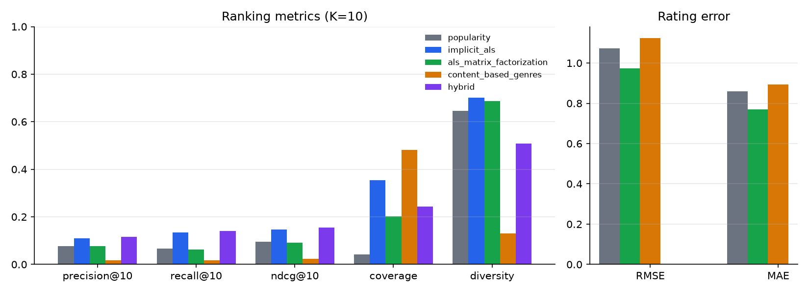<figcaption>Figure 2 — Ranking metrics (left) and rating error (right) per model.</figcaption></figure>

The personalized implicit ALS beats the popularity baseline on every ranking metric: NDCG@10 +54 %, recall doubled, and it recommends 35 % of the catalogue instead of 4 %. Its hyper-parameters (20 factors, α = 5) were picked from a 2 × 3 grid on a validation split carved from train by the same time rule (every candidate is a nested MLflow run; screenshot 15). The explicit ALS is the best rating predictor (RMSE 0.974 against 1.073 for the item-average baseline) but ranks no better than popularity: ranking by predicted rating favours obscure items with a few high ratings, which is exactly why a separate implicit model was added — the popularity prior in its ranking score only mitigates the effect. The content-based model is weak on accuracy but has the widest coverage and, as expected from a genre-similarity model, the lowest intra-list diversity. The **hybrid** blends the z-scored implicit ALS score with the user's genre affinity and the item popularity score, both read from the feature store; its weights (1.0 / 1.0 / 1.0) were chosen from a 5 × 5 grid on the same kind of validation split, with the features for that split rebuilt from its fit part alone. It is the best ranker — NDCG@10 0.1544 against 0.1476 for the implicit ALS it wraps (+5 %), +61 % over the baseline — at the price of coverage (24 % against 35 %) and diversity, which the popularity and genre terms pull down; it also returns a list for a user the collaborative model has never seen. The absolute numbers are modest because the split is strict (each user's *latest* 20 %, with taste drift and a 4-star relevance threshold); the comparison between models is what matters.

**Orchestration.** The Prefect run completes in about 16 s with all 12 task runs successful: the linear data stages, the fan-out into the four base training tasks, the hybrid after them and the fan-in to evaluation and the run manifest (screenshots 10–13). Two runs give identical metrics (fixed seed, deterministic solvers).

## 5. Requirements checklist

Every assignment requirement maps to a section of this report, the module that implements it and the screenshot that evidences it.

| # | Requirement | Section | Module | Evidence |
|---|---|---|---|---|
| 1 | Ingest raw user, item and interaction data from a real source | §2 (stage 1) | `src/ingestion` | Screenshot 1 |
| 2 | Land raw data unchanged and record provenance (source, SHA-256, row counts, injected faults) | §2 (stage 1) | `src/ingestion/ingest.py` → `data/raw/ingestion_manifest.json` | Screenshot 1 |
| 3 | Validate data quality — schema, ranges, categories, keys, referential integrity — and quarantine bad rows with reasons | §2 (stage 2), §4 | `src/validation` → `data/errors/*.csv`, `reports/validation_report.*` | Screenshots 2, 9 |
| 4 | Clean / standardize and split without leakage (per-user time split) | §2 (stage 3) | `src/preparation` → `data/processed/{train,test}.parquet` | Screenshot 3 |
| 5 | Build derived datasets / transformations from train only | §2 (stage 4) | `src/transformation` | Screenshot 4 |
| 6 | Feature engineering and a documented, versioned feature store | §2 (stage 5) | `src/features` → `data/features/`, `reports/feature_catalog.md` | Screenshot 5 |
| 7 | Train **at least two** models with experiment tracking | §2 (stage 6), §4 | `src/training` (5 models), MLflow | Screenshots 6, 14, 15 |
| 8 | Evaluate the models (ranking + rating-error metrics) | §2 (stage 7), §4 | `src/evaluation` | Screenshots 7, 16 |
| 9 | Orchestrate the pipeline — dependencies, retries, fan-out, schedule | §2 (stage 8) | `dags/recsys_pipeline_flow.py`, Prefect | Screenshots 10–13 |
| 10 | Reproducibility — one config, fixed seed, pinned dependencies | §7 | `configs/pipeline.yaml`, `requirements.txt` | §7 |
| 11 | Automated tests | §3 | `tests/` (11 tests) | Screenshot 8 |

## 6. Data lineage and storage layout

Each stage reads the previous stage's output and writes to its own folder, so the data has a single, inspectable path from the raw download to the trained models. Nothing downstream ever writes back upstream.

```
download ──▶ data/raw/        ml-100k.zip, {users,items,interactions}.csv, ingestion_manifest.json   (immutable landing)
             │
 validation ─┼─▶ data/errors/    {users,items,interactions}_errors.csv, validation_issues.csv         (quarantined rows + reasons)
             └─▶ data/processed/  {users,items,interactions}_validated.parquet                         (rows that passed)
                 │
 preparation ────┼─▶ data/processed/  {users,items,interactions}.parquet, train.parquet, test.parquet, split_metadata.json
                 │
 transformation ─┼─▶ data/processed/  user_activity_summary / item_popularity / item_genres .parquet, user_item_matrix.npz (+ index)
                 │
 features ────────┼─▶ data/features/   user_features (30) / item_features (29) / interaction_features (4) .parquet, registry.json, feature_metadata.json
                 │
 training ────────┼─▶ models/          <model>/{model.pkl, meta.json}, registry.json, training_summary.json   + MLflow runs
                 │
 evaluation ──────┴─▶ reports/         model_evaluation.{md,csv,json}, figures/metrics_comparison.png
 orchestration ─────▶ reports/run_manifest.json
```

**Data dictionary (main tables).**

| Table / file | Stage | Key columns |
|---|---|---|
| `raw/users.csv` | ingestion | `user_id`, `age`, `gender`, `occupation`, `zip_code` |
| `raw/items.csv` | ingestion | `item_id`, `title`, `release_date`, `imdb_url`, `genres` (19 flags) |
| `raw/interactions.csv` | ingestion | `user_id`, `item_id`, `rating` (1–5), `timestamp` |
| `errors/<table>_errors.csv` | validation | `source_row`, `reasons`, + the original columns of the rejected row |
| `processed/train.parquet`, `test.parquet` | preparation | cleaned `interactions`, per-user time split (80 / 20) |
| `processed/user_item_matrix.npz` | transformation | sparse 943 × 1,682 rating matrix (+ `matrix_index.json`) |
| `features/user_features.parquet` | features | 30 user features (activity, like-rate, genre affinities) |
| `features/item_features.parquet` | features | 29 item features (popularity, recency, genre one-hots) |
| `features/interaction_features.parquet` | features | 4 user × item features (genre affinity, popularity pct, …) |
| `models/<model>/meta.json` | training | class, parameters, training time, MLflow run id, feature version |

## 7. Reproducibility

The pipeline is deterministic end to end. It is driven by a single `configs/pipeline.yaml` (a second file switches it to the synthetic source), a fixed random seed (`42`), and NumPy-only ALS solvers, so two runs produce byte-identical metrics. Dependencies are pinned exactly in `requirements.txt` (Python 3.10+, developed and captured on **3.12.7**; pandas 3.1.0, NumPy 2.5.4, MLflow 3.18.0, Prefect 3.9.1), and the MovieLens download is SHA-256 verified. All generated data, models and tracking state are git-ignored and recreated by the pipeline, and the whole report — results table and all 16 screenshots — was regenerated from a **fresh clone** (`python -m venv .venv`, `pip install -r requirements.txt`, `make pipeline && make test`) on a clean machine before submission.

## 8. Limitations and future work

Cold-start users and items only get fallbacks (popularity for users, nothing learned for unseen items); the feature store is a set of Parquet files with a registry, not a service with point-in-time joins; evaluation is offline only, with binary relevance and no significance tests; there is no model registry or serving step after evaluation; MovieLens 100K is small and from 1998, so the figures do not transfer to a production catalogue; and the ALS implementations loop over users in Python, which is fine at this scale but would need a compiled solver (e.g. `implicit`) at millions of interactions. Natural next steps are a learned (rather than grid-tuned) blend for the hybrid, incremental feature refresh on a schedule, and a batch-scoring task that writes top-K lists for every user.

<div class="pagebreak"></div>

## Appendix A — Execution screenshots

Every stage was run with the commands in the README; each picture is the complete terminal output of that run, captured by `scripts/capture_screenshots.py`, followed by the Prefect and MLflow UIs for the orchestrated run.

<figure>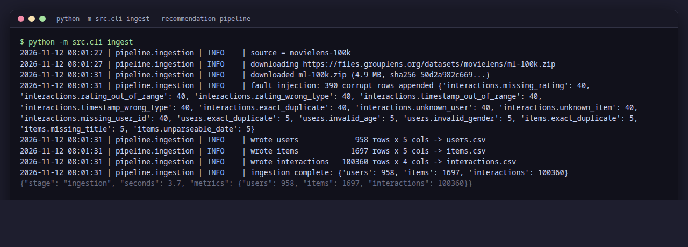<figcaption>Screenshot 1 — Stage 1, ingestion (fault injection on): download verified by checksum, 390 corrupt rows appended, three raw CSVs (958 users / 1,697 items / 100,360 interactions) and a manifest written.</figcaption></figure>
<figure>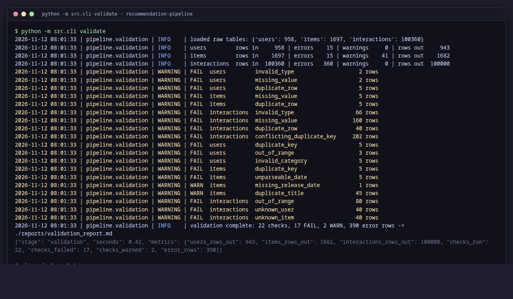<figcaption>Screenshot 2 — Stage 2, validation on MovieLens (fault injection on): the 390 appended rows are all rejected (15 users, 15 items, 360 interactions) and written to <code>data/errors/</code> with their reasons; the clean output is exactly 943 / 1,682 / 100,000.</figcaption></figure>
<figure>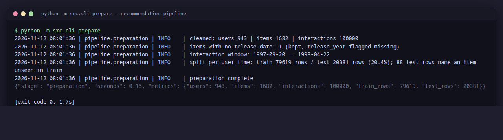<figcaption>Screenshot 3 — Stage 3, preparation: cleaning and the per-user time split (79,619 train / 20,381 test rows).</figcaption></figure>
<figure>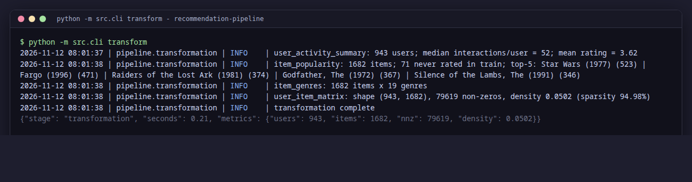<figcaption>Screenshot 4 — Stage 4, transformation: user activity summary, item popularity, genre table and the sparse user–item matrix.</figcaption></figure>
<figure>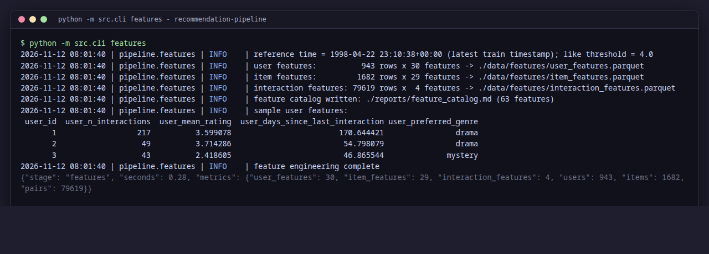<figcaption>Screenshot 5 — Stage 5, feature management: 63 catalogued features written to the feature store with the reference time.</figcaption></figure>
<figure>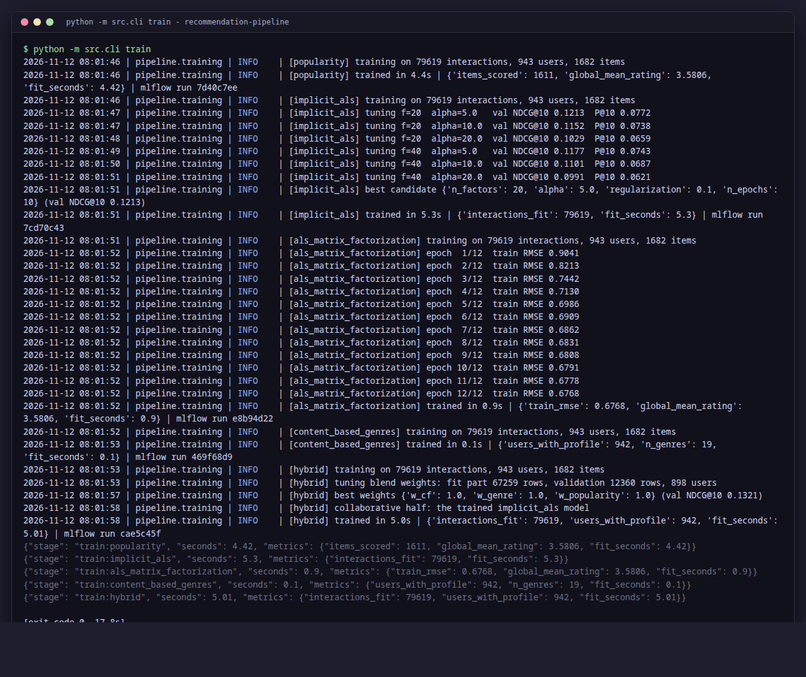<figcaption>Screenshot 6 — Stage 6, training: all five models (including the hybrid), the implicit ALS tuning grid, the hybrid blend-weight grid and the explicit ALS epoch RMSE, each with its MLflow run id.</figcaption></figure>
<figure>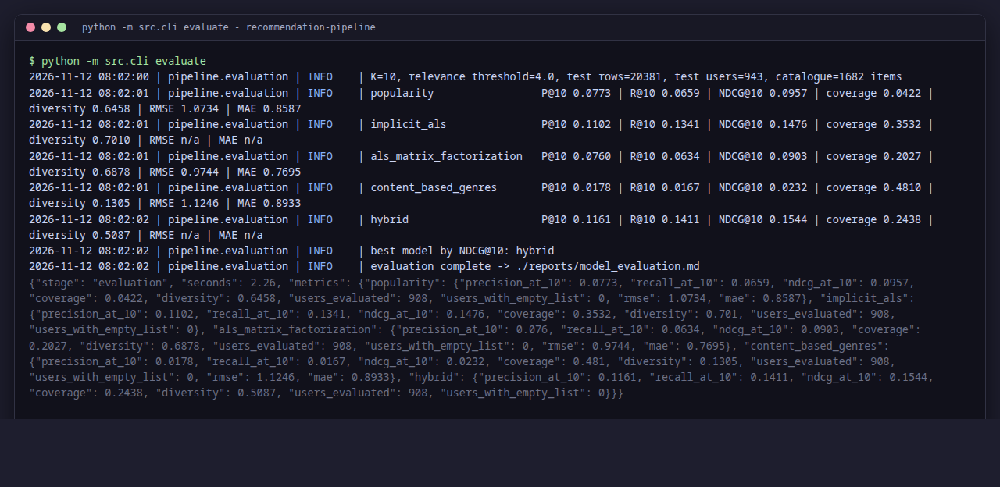<figcaption>Screenshot 7 — Stage 7, evaluation: Precision/Recall/NDCG@10, coverage, diversity, RMSE/MAE for all five models; best model by NDCG@10 is the hybrid.</figcaption></figure>
<figure>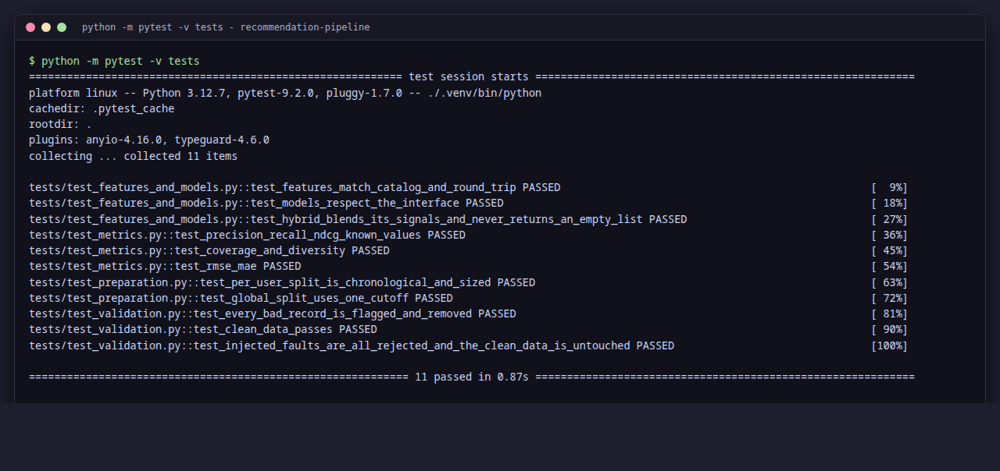<figcaption>Screenshot 8 — Unit tests (validation checks, time split, metrics, feature store, model interface).</figcaption></figure>
<figure>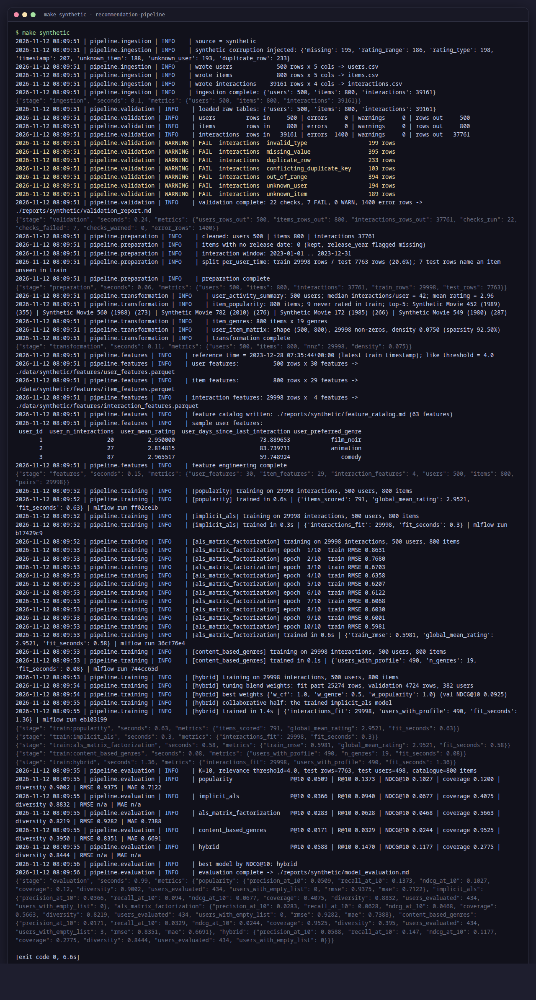<figcaption>Screenshot 9 — The whole pipeline on the synthetic dataset: validation rejects 1,400 injected bad rows of seven kinds, then the remaining stages (including all five models) run on the clean rows.</figcaption></figure>
<figure>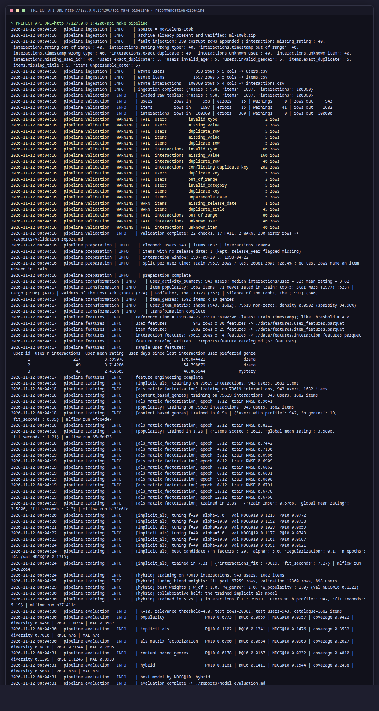<figcaption>Screenshot 10 — Stage 8, orchestration: the Prefect flow run from the terminal, every task run finishing in state Completed.</figcaption></figure>
<figure>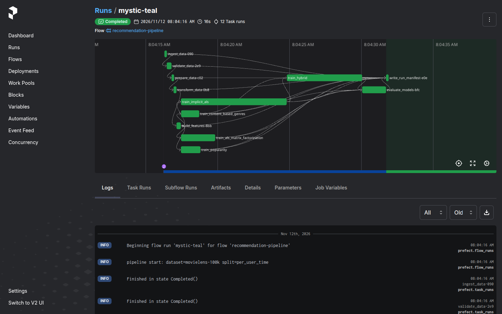<figcaption>Screenshot 11 — Prefect UI, the flow run: Completed, 12 task runs; the task graph shows the chain of data stages, the four parallel training tasks, the hybrid after them and the fan-in to evaluation.</figcaption></figure>
<figure>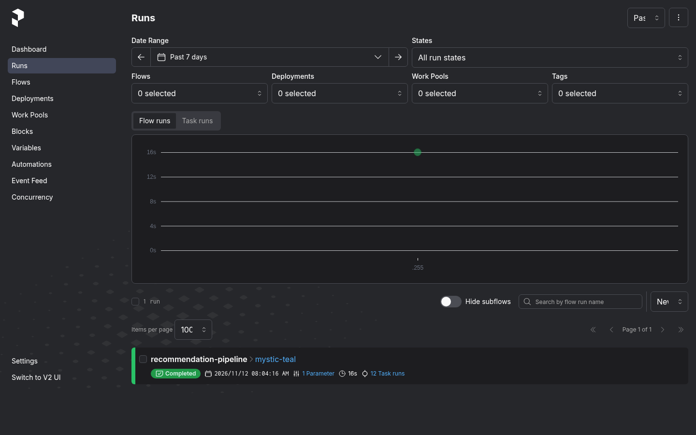<figcaption>Screenshot 12 — Prefect UI, runs list.</figcaption></figure>
<figure>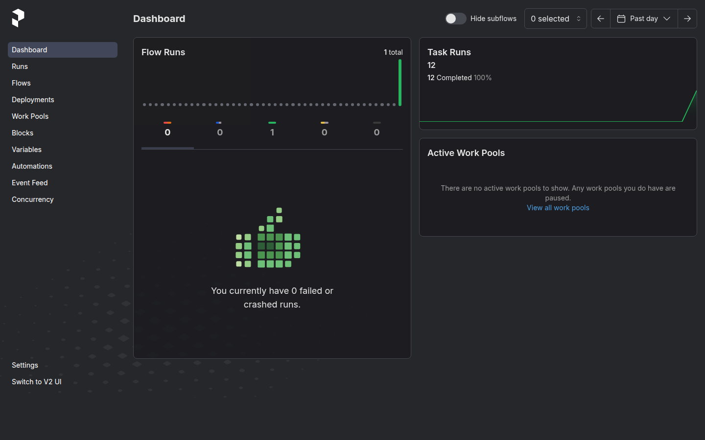<figcaption>Screenshot 13 — Prefect UI, dashboard: 12 of 12 task runs completed, 0 failed.</figcaption></figure>
<figure>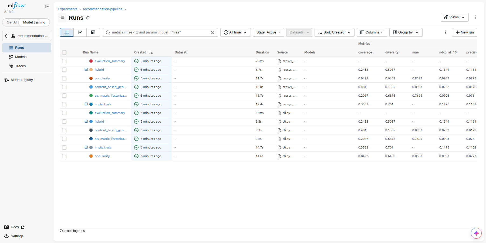<figcaption>Screenshot 14 — MLflow experiment: one run per model (plus the evaluation summary) for the stage-by-stage run (source <code>cli.py</code>) and for the orchestrated run (source <code>recsys_pipeline_flow.py</code>), with the evaluation metrics as columns.</figcaption></figure>
<figure>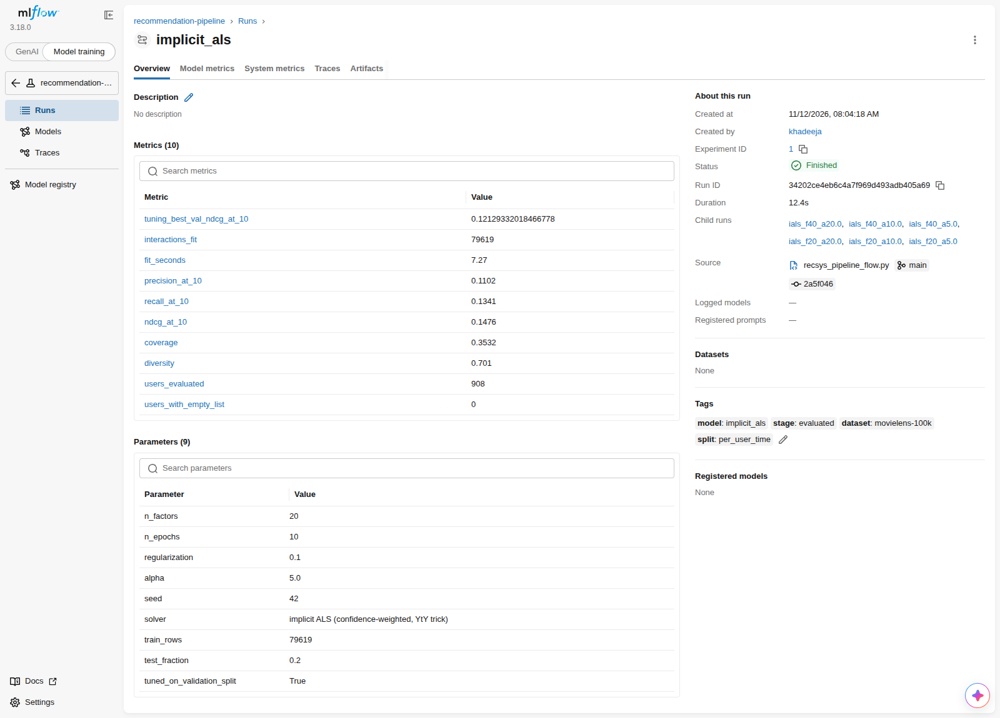<figcaption>Screenshot 15 — MLflow run page of the implicit ALS model: evaluation metrics, parameters (including the tuned values) and the six nested tuning runs.</figcaption></figure>
<figure>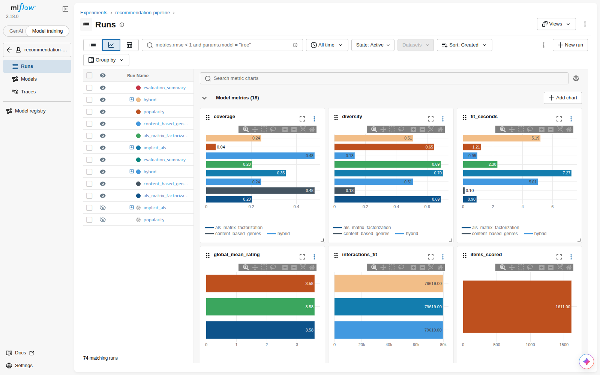<figcaption>Screenshot 16 — MLflow chart view comparing the runs' metrics.</figcaption></figure>

## Appendix B — Running it

Set-up (Python 3.10+, developed and captured on 3.12):

```bash
git clone https://github.com/Huzna-git/movielens-data-pipeline-dmml
cd movielens-data-pipeline-dmml
python -m venv .venv
source .venv/bin/activate
pip install -r requirements.txt
```

Run the pipeline and the tests:

```bash
make pipeline        # the whole pipeline as the Prefect flow, end to end  (~20 s)
make test            # the 11 unit tests                                   (~1 s)
make stages          # every stage in order, no orchestrator              (~30 s)
make synthetic       # the same pipeline on the synthetic dataset
```

Optional — the experiment-tracking and orchestration UIs:

```bash
make mlflow-ui       # MLflow UI    -> http://127.0.0.1:5000
make prefect-server  # Prefect UI   -> http://127.0.0.1:4200
```

Every screenshot in Appendix A was regenerated from a fresh run:
`python scripts/capture_screenshots.py stages` renders the terminal stages 1–8,
the synthetic (9) and orchestrated (10) runs are captured the same way, and
`scripts/capture_ui_screenshots.sh` captures the Prefect and MLflow UIs (11–16).
